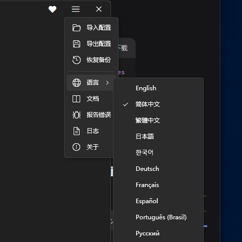
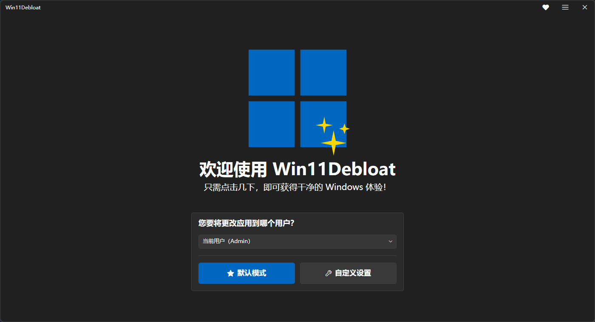
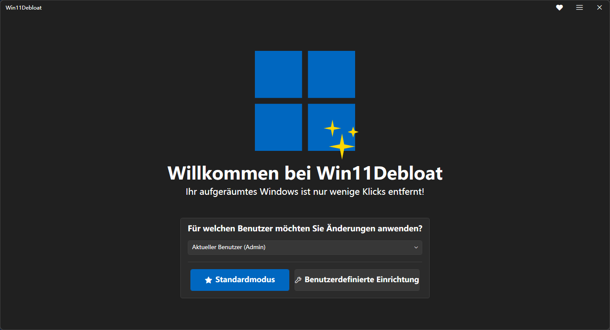
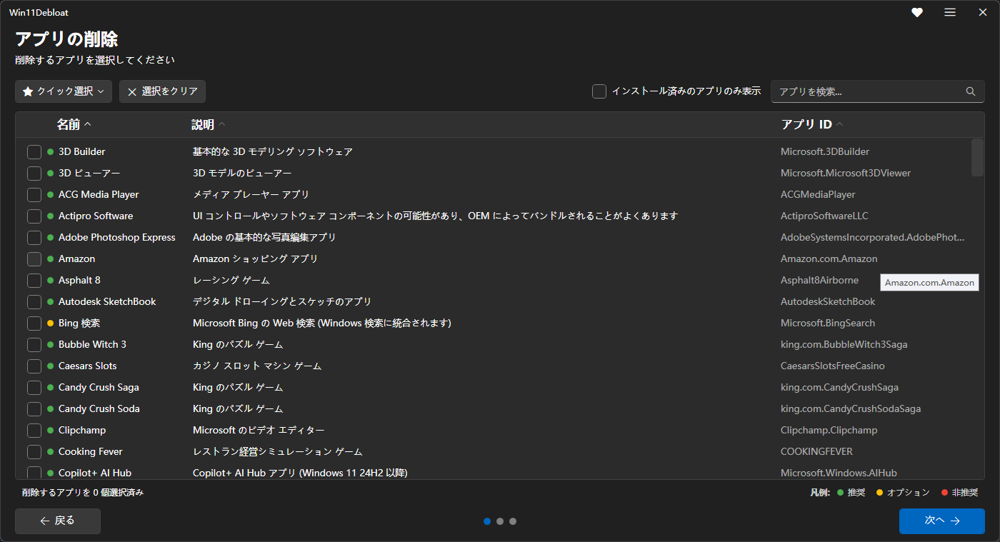

# Win11Debloat — Multilingual Edition

**English** | [简体中文](README.md)

[](https://github.com/wang13zhe/Win11Debloat/releases/latest)
[](https://github.com/wang13zhe/Win11Debloat/actions/workflows/tests.yml)
[](LICENSE)
[](https://github.com/Raphire/Win11Debloat)

> A community fork of [Raphire/Win11Debloat](https://github.com/Raphire/Win11Debloat) with the same debloating
> capabilities, plus a GUI translated into **10 languages** that follows your Windows display language.



## ✨ What this fork adds

- 🌍 **10 interface languages** — English, 简体中文, 繁體中文, 日本語, 한국어, Deutsch, Français, Español, Português (Brasil), Русский
- 🧭 **Automatic language selection** — exact culture match, then language prefix fallback (`de-AT` → `de-DE`, `zh-HK` → `zh-TW`), then English
- 🔄 **Switch at runtime** — `☰` → Language; the window is rebuilt in the selected language and the choice is stored in `Config/Language.json`
- 📦 **Complete translations** — window chrome, feature labels and tooltips, categories, and every app name and description
- 🩹 **Fixes along the way** — language files were read without `-Encoding UTF8` (CJK/Cyrillic packs came out garbled or empty), long labels were clipped

## 🌐 Supported languages

| Language | Code | UI | Features | Apps |
| --- | --- | :-: | :-: | :-: |
| English | `en-US` | ✅ | ✅ | ✅ |
| 简体中文 | `zh-CN` | ✅ | ✅ | ✅ |
| 繁體中文 | `zh-TW` | ✅ | ✅ | ✅ |
| 日本語 | `ja-JP` | ✅ | ✅ | ✅ |
| 한국어 | `ko-KR` | ✅ | ✅ | ✅ |
| Deutsch | `de-DE` | ✅ | ✅ | ✅ |
| Français | `fr-FR` | ✅ | ✅ | ✅ |
| Español | `es-ES` | ✅ | ✅ | ✅ |
| Português (Brasil) | `pt-BR` | ✅ | ✅ | ✅ |
| Русский | `ru-RU` | ✅ | ✅ | ✅ |

| English | Deutsch |
| --- | --- |
|  |  |

App list in Japanese:



## 🚀 Usage

1. Download `Win11Debloat-CN-*.zip` from [Releases](https://github.com/wang13zhe/Win11Debloat/releases/latest)
2. Extract it to any folder (**do not run it from inside the archive**)
3. Double-click `Run.bat` and accept the UAC prompt
4. Use `☰` → Language to switch the interface language at any time

Or pick the language from the command line:

```powershell
.\Win11Debloat.ps1 -Language de-DE
```

Without `-Language` the app uses the language picked in the GUI, then the Windows display language, then English.

## 📋 Requirements

- Windows 10 / Windows 11
- **Windows PowerShell 5.1** (built in). PowerShell 7 / pwsh is not supported
- Administrator rights (the script edits the registry and removes preinstalled apps)

## ⚠️ Notes

The script modifies the registry and removes preinstalled apps — **create a restore point first**. Most changes can be reverted from inside the tool, and removed apps can be reinstalled from the Microsoft Store.

> If `Run.bat` closes immediately, open an elevated PowerShell, `cd` into the extracted folder and run `.\Win11Debloat.ps1`.

## 🔗 Relation to upstream

- The debloating engine comes from upstream; this fork only changes the localization layer (`Config/Languages/`) and a small amount of supporting code
- Six language-pack PRs and one UTF-8 fix PR are open upstream: [#838 – #844](https://github.com/Raphire/Win11Debloat/pulls?q=is%3Apr+author%3Awang13zhe)
- Upstream changes are merged into this fork; translation issues are welcome in [Issues](https://github.com/wang13zhe/Win11Debloat/issues)

For the full feature set (app list, command-line parameters, Sysprep, configuration import/export), see the [upstream wiki](https://github.com/Raphire/Win11Debloat/wiki).

## 🙏 Credits & license

- Original author [Raphire](https://github.com/Raphire) and all upstream contributors. Released under the [MIT license](LICENSE).
- If the tool is useful to you, star the [upstream repository](https://github.com/Raphire/Win11Debloat) or [buy the author a coffee](https://ko-fi.com/M4M5C6UPC).
