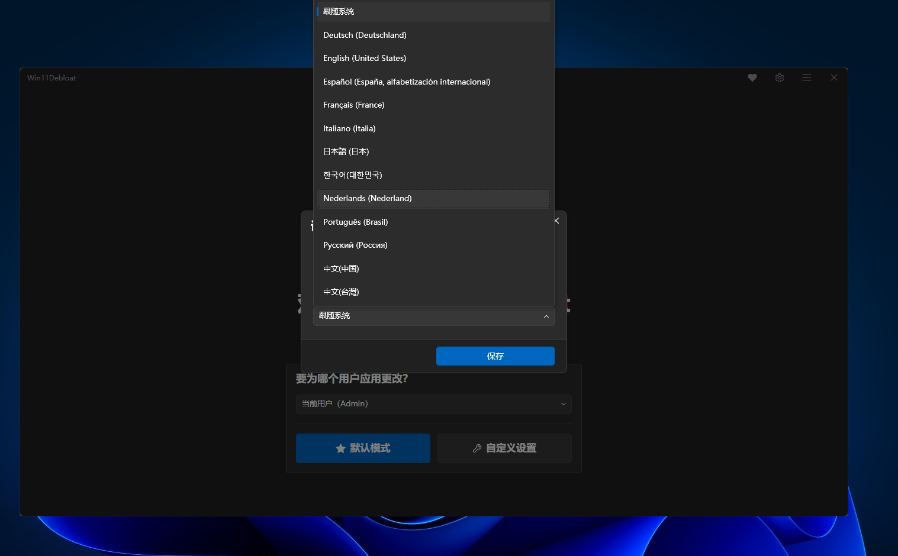
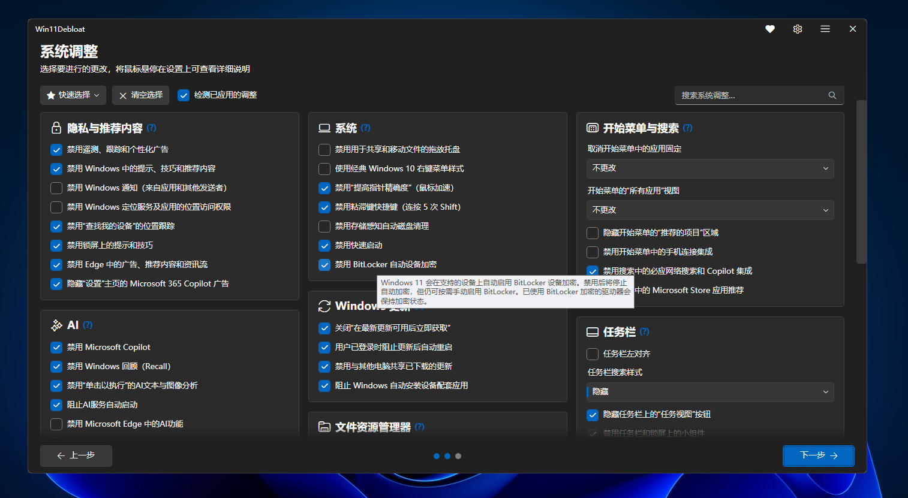
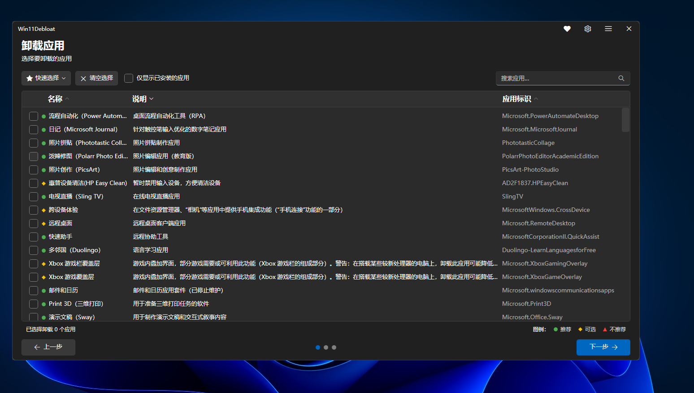

# Win11Debloat — Édition multilingue

[简体中文](README.md) | [English](README-en_US.md) | Français

[](https://github.com/wang13zhe/Win11Debloat/releases/latest)
[](https://github.com/wang13zhe/Win11Debloat/actions/workflows/tests.yml)
[](LICENSE)
[](https://github.com/Raphire/Win11Debloat)

> Une branche communautaire de [Raphire/Win11Debloat](https://github.com/Raphire/Win11Debloat).
> Conserve toutes les capacités de déplombage d'origine — **l'interface est disponible en 12 langues et suit automatiquement la langue de votre système**.



## ✨ Ce que cette branche ajoute

- 🌍 **12 langues pour l'interface** — 简体中文, 繁體中文, English, 日本語, 한국어, Deutsch, Français, Español, Italiano, Nederlands, Português (Brasil), Русский
- 🧭 **Détection automatique de la langue du système** — correspondance exacte de la région → repli sur un préfixe de langue identique (`de-AT` utilise `de-DE`, `zh-HK` utilise `zh-TW`) → anglais en dernier recours
- 🔄 **Changement de langue à tout moment sans perdre vos coches** — ⚙ en haut à droite → Language ; l'interface s'actualise sur place, donc **les éléments que vous avez déjà cochés ne sont pas réinitialisés**
- 📦 **Traduction complète** — le texte de l'interface, les descriptions et infobulles des fonctionnalités, les catégories, ainsi que le nom et la description de chaque application sont localisés, et non pas seulement une coquille
- ⚡ **Lectures d'état plus rapides** — la résolution des chemins de registre, l'analyse des fichiers `.reg` et les requêtes Appx sont mises en cache pour un seul rafraîchissement d'état ; la lecture de l'état de chaque fonctionnalité a été mesurée environ 19 % plus rapide
- 🩹 **Bogues corrigés en cours de route** — les fichiers de langue et de configuration n'étaient pas lus en UTF-8 (le japonais/russe affichait des caractères corrompus ou même des listes vides), les traductions longues étaient tronquées, et un test produisait un faux échec sur les systèmes non anglophones

## 🌐 Langues prises en charge

| Langue | Code | Interface | Descriptions des fonctionnalités | Descriptions des applications |
| --- | --- :-: | :-: | :-: | :-: |
| 简体中文 | `zh-CN` | ✅ | ✅ | ✅ |
| 繁體中文 | `zh-TW` | ✅ | ✅ | ✅ |
| English | `en-US` | ✅ | ✅ | ✅ |
| 日本語 | `ja-JP` | ✅ | ✅ | ✅ |
| 한국어 | `ko-KR` | ✅ | ✅ | ✅ |
| Deutsch | `de-DE` | ✅ | ✅ | ✅ |
| Français | `fr-FR` | ✅ | ✅ | ✅ |
| Español | `es-ES` | ✅ | ✅ | ✅ |
| Italiano | `it-IT` | ✅ | ✅ | ✅ |
| Nederlands | `nl-NL` | ✅ | ✅ | ✅ |
| Português (Brasil) | `pt-BR` | ✅ | ✅ | ✅ |
| Русский | `ru-RU` | ✅ | ✅ | ✅ |

Parmi celles-ci, `en-US`, `it-IT`, `ja-JP`, `nl-NL`, `pt-BR` et `zh-CN` proviennent de l'amont (upstream) ;
`de-DE`, `es-ES`, `fr-FR`, `ko-KR`, `ru-RU` et `zh-TW` sont maintenues par cette branche et soumises en amont sous forme de PR.

## 📸 Captures d'écran

Vous pouvez changer de langue directement dans les paramètres (par défaut « Follow system ») :


Éléments de fonctionnalités et leurs infobulles, localisés :



La page de suppression d'applications : les noms, descriptions et avertissements d'applications sont localisés, tandis que l'`AppId` reste verbatim pour le dépannage :



## 🚀 Utilisation

1. Téléchargez `Win11Debloat-CN-*.zip` depuis [Releases](https://github.com/wang13zhe/Win11Debloat/releases/latest)
2. Extrayez dans n'importe quel dossier (**n'exécutez pas depuis l'intérieur du zip**)
3. Double-cliquez sur `Run.bat` et cliquez sur « Oui » à l'invite UAC
4. Une fois ouvert, changez le thème et la langue de l'interface à tout moment via la ⚙ en haut à droite

Vous pouvez également choisir une langue directement en ligne de commande :

```powershell
.\Win11Debloat.ps1 -Language de-DE
```

Lorsqu'elle n'est pas spécifiée, l'ordre est : argument `-Language` → le choix enregistré dans l'interface → langue du système → anglais.
Le choix de l'interface est enregistré dans `%LOCALAPPDATA%\Win11Debloat\Preferences.json` ; les journaux se trouvent dans `Logs\` sous le même dossier.

## 📋 Prérequis

- Windows 10 / Windows 11
- **Windows PowerShell 5.1** (fourni avec le système d'exploitation). Le script ne prend pas en charge PowerShell 7 / pwsh
- Droits d'administrateur (il modifie le registre et supprime des applications préinstallées)

## ⚠️ Mises en garde

Cet outil modifie le registre et supprime des applications préinstallées, donc **cochez toujours d'abord « Create a system restore point »** — utilisez-le à vos propres risques.
La plupart des modifications peuvent être annulées avec la fonction « Restore » intégrée à l'outil, et les applications supprimées peuvent être réinstallées depuis le Microsoft Store.

> Si `Run.bat` s'affiche puis disparaît, ouvrez PowerShell en tant qu'administrateur manuellement, placez-vous (`cd`) dans le dossier extrait et exécutez `.\Win11Debloat.ps1`.

## 🔗 Relation avec l'amont (upstream)

- Cette branche est **basée directement sur `master` de `Raphire/Win11Debloat`** et ne superpose que des packs de langue et de petites corrections, afin de pouvoir continuer à suivre l'amont
- Les packs de langue suivent la convention de l'amont « une PR par langue », plus deux PR pour la correction de lecture UTF-8 et les corrections de libellés
- Déjà fusionné en amont : [#844](https://github.com/Raphire/Win11Debloat/pull/844) (lecture UTF-8), [#846](https://github.com/Raphire/Win11Debloat/pull/846) (quatre corrections de chaînes sources)
- Encore en cours d'examen : les six PR de packs de langue `zh-TW`, `de-DE`, `es-ES`, `fr-FR`, `ko-KR`, `ru-RU`
- Signalez les problèmes de traduction dans [Issues](https://github.com/wang13zhe/Win11Debloat/issues)

Pour l'ensemble des fonctionnalités d'origine (liste de suppression d'applications, arguments en ligne de commande, Sysprep, export/import de configuration, etc.), voir le [Wiki amont](https://github.com/Raphire/Win11Debloat/wiki).

## 🙏 Crédits et licence

- Auteur original [Raphire](https://github.com/Raphire) et tous les contributeurs ; ce projet est sous [licence MIT](LICENSE)
- Si vous aimez l'outil, donnez une étoile à l'auteur sur le [dépôt amont](https://github.com/Raphire/Win11Debloat), ou [offrez-leur un café](https://ko-fi.com/M4M5C6UPC)

---

## 🌐 Autres versions linguistiques

- [简体中文](README.md)
- [English](README-en_US.md)
- [繁體中文](README-zh_TW.md)
- [日本語](README-ja_JP.md)
- [한국어](README-ko_KR.md)
- [Deutsch](README-de_DE.md)
- [Français](README-fr_FR.md)
- [Español](README-es_ES.md)
- [Italiano](README-it_IT.md)
- [Nederlands](README-nl_NL.md)
- [Português (Brasil)](README-pt_BR.md)
- [Русский](README-ru_RU.md)
